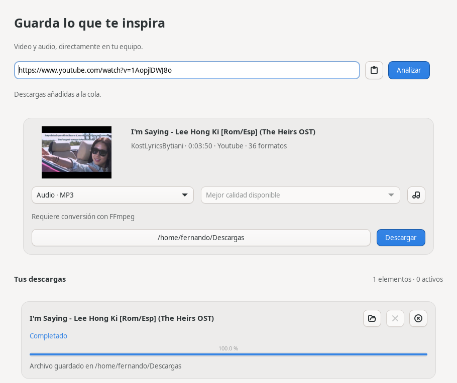

# Media Downloader GTK

A native Linux desktop interface for [yt-dlp](https://github.com/yt-dlp/yt-dlp),
written in C11 with GTK4, GLib and GIO. Analyze and download authorized video
and audio without accounts, a backend, advertising or telemetry. The application
interface is in Spanish; contributor documentation is in English.

## Features

- Asynchronous metadata analysis: title, author, duration, source, thumbnails
  when provided by the source, and reported format information.
- MP4, WebM and MKV with compatible codec selection. Only reported video
  resolutions are offered; incompatible selections display an explanation.
- MP3, M4A, Opus, FLAC and WAV extraction using FFmpeg, with installed encoder checks.
- Structured `--progress-template` JSON: current-track bytes, speed, ETA,
  fragments and postprocessing stages. A job completes only after process exit
  and output draining, including FFmpeg processing.
- Concurrent queue (two downloads by default, configurable from one to eight),
  cancellation of process groups, retry, open destination and remove list items.
- Playlist analysis (first 100 items), individual or all-item selection, and
  explicit confirmation before enqueueing playlist content.
- Persistent preferences in a private GLib key file; system, light and dark theme
  settings; completion notifications and optional folder opening.
- Startup checks for stable yt-dlp and application releases on GitHub, with an
  explicit engine-update button and a link to newer application releases.
- Natural filenames preserving spaces and Unicode characters.
- MIT-licensed original code and icon. yt-dlp and FFmpeg remain external dependencies.



## Requirements

Ubuntu 24.04 or a compatible Debian-based distribution, GTK >= 4.6,
GLib / GIO >= 2.70, JSON-GLib >= 1.6, libsoup >= 3.0, yt-dlp >= 2023.03.04 and FFmpeg.
Source sites evolve: use an appropriately maintained yt-dlp installation.
For current YouTube extraction, yt-dlp also needs its EJS components and a
supported JavaScript runtime; see the [upstream EJS setup guide](https://github.com/yt-dlp/yt-dlp/wiki/EJS).
These are external engine requirements; the application and interface remain C11.
The Ubuntu-built `.deb` uses Ubuntu ABI package names; build a package on Debian
for Debian rather than assuming Ubuntu binaries are interchangeable.

JSON-GLib is used for typed metadata and progress parsing instead of adding a
custom JSON parser. libsoup provides native HTTPS for update checks and downloads,
with cancellable worker operations, timeouts and bounded response sizes. Thumbnails are retrieved by a separate cancellable yt-dlp
process and converted to PNG by FFmpeg; this keeps media extraction under the same engine.

## Install a Debian package

After building or downloading the appropriate package for your distribution:

```sh
sudo apt install ./dist/media-downloader-gtk_1.0.0-1_amd64.deb
media-downloader-gtk
sudo apt remove media-downloader-gtk
```

The application itself runs as a normal user. APT installs yt-dlp and FFmpeg
as declared dependencies; the application does not install dependencies.

## Build from source

```sh
sudo apt update
sudo apt install build-essential pkg-config meson ninja-build libgtk-4-dev \
  libglib2.0-dev libjson-glib-dev libsoup-3.0-dev yt-dlp ffmpeg dpkg-dev
meson setup build --prefix=/usr/local
meson compile -C build
meson test -C build --print-errorlogs
./build/media-downloader-gtk
```

Compatibility is deliberately limited to GTK 4.6 APIs so stable distributions
can build the same source. Newer GTK headers are treated as system headers and
API deprecation checks use the supported minimum version; project warnings
(`-Wall -Wextra -Wpedantic`) remain errors.

Install or uninstall a source build:

```sh
sudo meson install -C build
sudo ninja -C build uninstall
```

For a user-only installation, configure a separate build with
`--prefix="$HOME/.local"` and run `meson install` without sudo.
On the initial development machine, dependencies were extracted to ignored
`.tools/` files to avoid system changes. If present, `scripts/dev-env.sh meson ...`
uses those local tools. They are not bundled or required by a normal build.

## Usage

1. Paste an HTTP(S) URL and press **Analizar**. Pasting never starts a download.
2. Review the metadata, format and available resolution. The musical-note button
   selects the preferred audio format from preferences.
3. Select a writable destination folder and press **Descargar**.
4. For playlists, select items and confirm adding them to the queue.
5. Use the row controls to cancel, retry, open the folder or remove finished rows.

Explicit light/dark choices use GTK’s built-in theme variants so they also work
with a dark-only desktop theme or a forced `GTK_THEME`. The theme button toggles
the visible appearance and saves the choice. Selecting **Sistema** in preferences
restores the desktop theme.

Progress accumulates across tracks and never decreases within an attempt, even when
yt-dlp revises size estimates. Fragmented downloads use the completed fragment
count while their byte total remains estimated, including initialization fragments.
Downloads occupy 95% of the bar; processing retains
that progress until successful completion reaches 100%. Per-track sizes remain visible.
Unknown values are shown as `—`. Cancellation preserves partial files for retries.
Audio selection respects yt-dlp’s original/default language preference before
comparing bitrate. When provided by the source, the selected audio language is
shown beside the format selection. If language metadata is unavailable, quality
ranking is used.
Filenames retain spaces and Unicode; yt-dlp still sanitizes characters that cannot
be used in file paths. Existing output files are not overwritten. Removing a row never deletes files.
Closing the main window cancels running jobs and waits for process cleanup.

Preferences live at `$XDG_CONFIG_HOME/media-downloader-gtk/preferences.ini`
(default `~/.config/media-downloader-gtk/preferences.ini`). History and URLs are
kept only during the session; preferences contain no credentials. User preferences
remain after package removal, as is normal for desktop applications.

## Updates

Opening the main window checks the latest published stable GitHub Release of
both yt-dlp and this application. The checks run in the background; failures,
rate limits or no published application release do not prevent local downloads.
Use the refresh icon in the header to check again.

When a newer engine is available, **Actualizar yt-dlp** downloads the official
Unix executable only after a click. The download is checked against SHA-256
from GitHub's release digest or its official checksum list, and its `--version`
is checked before atomic replacement. Failed or cancelled updates preserve the
existing executable. No administrator access or system package replacement is
needed. Updates are disabled while analysis or download processes are active.

The managed executable lives in
`$XDG_DATA_HOME/media-downloader-gtk/bin/yt-dlp`
(default `~/.local/share/media-downloader-gtk/bin/yt-dlp`). This copy takes
precedence over the system executable. Python >= 3.10 is needed by the official
Unix engine; current YouTube support also needs its bundled EJS scripts and a
supported runtime. The app enables compatible Deno >= 2.3 or Node >= 22 found
in `PATH` when the selected yt-dlp supports `--js-runtimes`. It also checks
already-installed Node versions under NVM if the default Node is too old. It does not install
JavaScript runtimes. The application and interface remain C11.

**Descargar nueva versión** opens the newer application Release page so the
user can download the appropriate package. Application updates are not silently
installed. GitHub Releases, rather than individual commits, define available
application versions; no stable Release has been published yet.

Update requests contact GitHub anonymously over HTTPS and send no URLs,
download history, preferences or credentials. There is no application telemetry.

## Tests

```sh
meson test -C build --print-errorlogs
python3 tests/run-integration.py
# Optional full GTK integration, on an isolated virtual display:
sudo apt install xvfb dbus-x11 at-spi2-core
MD_TEST_UI=1 G_DEBUG=fatal-warnings GDK_BACKEND=x11 GSK_RENDERER=cairo \
  dbus-run-session -- xvfb-run -a python3 tests/run-integration.py
```

Unit tests cover URL validation, units, malformed and valid JSON, codec/container
selection, missing resolutions, unknown progress fields, queue cancellation and
retry, real subprocess success/failure/cancellation (including descendants after
parent exit), and preference persistence. Update tests cover numeric version ordering,
release URL validation, rejected drafts, digest verification, failed/cancelled
installation preserving the existing executable, and atomic replacement.
Integration tests generate original synthetic media with FFmpeg, serve it on
loopback, and run the actual application engine using yt-dlp and FFmpeg. Separate DASH video/audio tracks are combined into MP4 and MKV, and VP9/Opus
tracks into WebM. Queue concurrency, active cancellation and HTTP errors are
also checked. Outputs
are verified with ffprobe and existing files must remain unchanged. Python is
used only in the test harness; the application and UI are entirely C.
GUI integration drives the real widgets through analysis, download and clean exit.

## Packaging

```sh
scripts/build-deb.sh build
```

The script stages a Meson installation, derives ABI dependencies using
`dpkg-shlibdeps` and produces a root-owned `.deb` using `dpkg-deb`.
It includes the binary, desktop entry, scalable original icon, license and
copyright information; it does not bundle dependencies or install scripts.
The build directory's install prefix becomes `/usr` for packaging.
Traditional debhelper metadata is also provided in `packaging/debian`.

To validate installation and removal without changing the host:

```sh
docker run --rm --init -v "$PWD/dist:/packages:ro" \
  -v "$PWD/scripts/verify-package.sh:/verify-package.sh:ro" ubuntu:24.04 \
  sh /verify-package.sh /packages/media-downloader-gtk_1.0.0-1_amd64.deb
```

This checks APT dependency resolution, desktop-file validation, dynamic linking,
non-root graphical startup in Xvfb and APT removal. Docker access is required.

## Architecture and contribution

- `window.c`: GTK widgets and asynchronous user interaction.
- `video-info.c`: validated JSON metadata and playlist items.
- `format-selector.c`: native containers, compatible tracks and actual resolutions.
- `downloader.c`: asynchronous subprocess streams, JSON progress, dependency checks.
- `download-manager.c`: independent jobs, bounded queue and state transitions.
- `preferences.c`: atomic local GLib key-file persistence.
- `updates.c`: bounded GitHub HTTP checks and verified atomic engine updates.
- `engine.c`: managed/system engine resolution and compatible runtime selection.
- `utils.c`: URL, duration, byte and destination validation.

Pass process arguments as individual argv entries and terminate the option list
before URLs. User inputs never become shell commands. `--ignore-config` prevents
external yt-dlp configuration from injecting additional behavior. GTK updates
and job state changes run on the GLib main context; dependency probing uses a
worker. All owned processes are drained and reaped before their data is released.

GitHub CI builds, tests, packages and verifies installation on Ubuntu 24.04.
The manually triggered release workflow creates an **unpublished draft** from
an existing authorized `v1.0.0` tag. Publishing requires a separate owner action.
See [release preparation](docs/RELEASE_NOTES.md) and [validation](docs/VALIDATION.md).

## License, acknowledgements and lawful use

Original code and artwork: [MIT](LICENSE), copyright 2026 Fernando Rojas.
External software has its own licensing: see [THIRD_PARTY.md](THIRD_PARTY.md).
Thanks to the yt-dlp, FFmpeg, GTK, GLib and JSON-GLib projects and contributors.

Download only your own content, public-domain material, permissively licensed
content or material you are authorized to download. Respect copyright, site
terms and applicable law. Personal use does not automatically make downloading
lawful. This project does not bypass DRM, extract browser cookies, evade
authentication or provide access-restriction bypass mechanisms.

Source repository: [ingferchorojas/media-downloader-gtk](https://github.com/ingferchorojas/media-downloader-gtk).
Published release: [v1.0.0](https://github.com/ingferchorojas/media-downloader-gtk/releases/tag/v1.0.0).
Later fixes in `main` are available in locally built packages until a new release is published.
